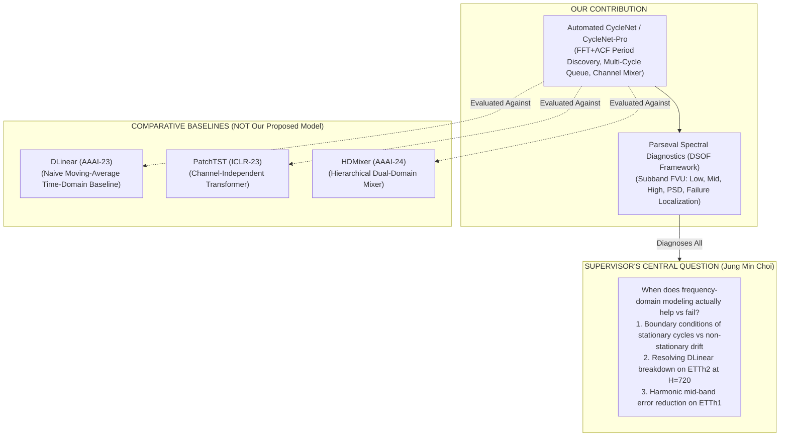

# AI-Assisted Research & Development Methodology Protocol
> **Document:** `docs/ai_development_methodology.md`  
> **Purpose:** Eliminate AI context drift, model confusion, experimental divergence, and phantom results across sessions.  
> **Audience:** Human Researchers & AI Pair Programmers (Antigravity, Claude, ChatGPT, etc.)

---

## 1. Executive Summary & Root Cause Analysis

### The Failure Mode That Occurred
In collaborative research developed with AI assistants across multiple sessions, a subtle but serious problem repeatedly arises:
1. **Model Drift:** One session implements and runs benchmarks on **CycleNet** (the supervisor's mandate). A later session, prompted to draft or polish LaTeX text, encounters references to DLinear or an older prototype ("DSOF"), and silently shifts the entire manuscript narrative toward DLinear.
2. **Context Amnesia:** Language models treat each chat or session independently unless explicitly anchored. Without persistent, inviolable rules, models "solve" the immediate prompt by making convenient assumptions (e.g., inventing numbers, substituting architectures, or redefining data splits).
3. **Ghost Metrics:** AI drafts tables with plausible-looking numbers (e.g. from memory of general papers or HDMixer) rather than pulling verified metrics from actual benchmark outputs.

### The Solution: The Anti-Drift Governance Framework
To prevent this, the project enforces a multi-tier governance structure:
- **Level 0 (Automated System Prompt Rules):** [`AGENTS.md`](file:///d:/uni/SRP26/AGENTS.md) at repo root and [`.agents/rules/project_rules.md`](file:///d:/uni/SRP26/.agents/rules/project_rules.md) are automatically injected into the AI context window on every turn.
- **Level 1 (Ground Truth Hierarchy):** Strict separation between code/results (ground truth) and manuscript text (derived reflection).
- **Level 2 (Session Handoff Protocols):** Compulsory reading and writing of [`.ai_history/`](file:///d:/uni/SRP26/.ai_history/) session logs.
- **Level 3 (Verification Gates):** Mandatory check gates before committing code or paper changes.

---

## 2. The Core Entity & Model Taxonomy

Any AI working on this repository MUST abide by the following classification. **No exceptions.**



### Definitions:
1. **Automated CycleNet (CycleNet-Pro)**:
   - **File:** [`models/cyclenet/`](file:///d:/uni/SRP26/models/cyclenet/), [`experiment_cyclenet.py`](file:///d:/uni/SRP26/experiment_cyclenet.py).
   - **Nature:** The core model being developed and defended. Uses automated multi-cycle period detection via FFT+ACF and recurrent state modeling.
2. **DLinear**:
   - **Nature:** A simple linear baseline (Zeng et al., 2023) decomposing signals into Trend + Seasonality via moving average. Used in our study to show *why* naive decomposition breaks down on long horizons ($H=720$) or complex harmonics.
   - **Warning for AI:** NEVER describe DLinear as the proposed architecture in the paper.
3. **Parseval Subband Decomposition (DSOF Framework)**:
   - **File:** [`metrics.py`](file:///d:/uni/SRP26/metrics.py), [`diagnostics.py`](file:///d:/uni/SRP26/diagnostics.py).
   - **Nature:** The mathematical diagnostic apparatus dividing the spectrum into Low ($T \ge 10\text{ h}$), Mid ($2.5\text{ h} \le T < 10\text{ h}$), and High ($2\text{ h} \le T < 2.5\text{ h}$) bands, computing subband MSE, Fraction of Variance Unexplained ($FVU$), and PSD.

---

## 3. The 5 Invariant Rules for AI Assistants

### Rule 1: The Code-and-Result Ground-Truth Gate
- If a claim in `paper/main.tex` contradicts the code in `models/` or the numbers in `results/`, the **code/results win**.
- The AI must immediately update the manuscript to match empirical reality, not vice versa.

### Rule 2: Zero-Tolerance on Hallucinated Numbers
- Every performance metric reported for CycleNet must be linked to a concrete result file:
  - Markdown summary: [`results/cyclenet/cyclenet_benchmark_summary.md`](file:///d:/uni/SRP26/results/cyclenet/cyclenet_benchmark_summary.md)
  - Raw CSV: [`results/cyclenet/cyclenet_benchmark_summary.csv`](file:///d:/uni/SRP26/results/cyclenet/cyclenet_benchmark_summary.csv)
- Baseline numbers must come directly from established literature tables (HDMixer, PatchTST, DLinear papers). AI must never guess or adjust these values.

### Rule 3: Strict Adherence to the Standardization Protocol
- All new experiments must strictly execute according to [`docs/experiment_standardization_protocol.md`](file:///d:/uni/SRP26/docs/experiment_standardization_protocol.md):
  - $L = 336$, $H \in \{96, 192, 336, 720\}$.
  - Canonical ETT splits: 12/4/4 months. Non-ETT: 70/10/20.
  - History overlap ($L$) preserved for val and test slices.
  - RevIN enabled, scaler fitted strictly on train.
  - Multi-seed `[2024, 2025, 2026]`.

### Rule 4: Publication-Quality LaTeX Maintenance
- Any edits to `paper/main.tex` or figures must be followed by a verification step:
  ```powershell
  cd d:\uni\SRP26\paper
  pdflatex -interaction=nonstopmode main.tex
  ```
- The output PDF must compile with **0 errors**.

### Rule 5: Mandatory Session History Logging
- At the start of a session: read the most recent file in [`.ai_history/`](file:///d:/uni/SRP26/.ai_history/).
- At the close of a session: append or create `.ai_history/session_log_YYYYMMDD.md` summarizing:
  1. What was requested and what was completed.
  2. Any code or paper changes made.
  3. Experimental results produced.
  4. Next concrete steps.

---

## 4. How the Human Researcher Enforces This

When starting a conversation with any AI model (in Antigravity, Claude, ChatGPT, or web interfaces), paste the following **AI Priming Directive**:

```markdown
You are assisting on the SRP26 project (University of Hildesheim, Supervisor: Jung Min Choi).
Before taking any action, read AGENTS.md, docs/ai_development_methodology.md, and the latest log in .ai_history/.
Our proposed model is Automated CycleNet (CycleNet-Pro); DLinear is strictly a baseline.
All empirical metrics must be drawn directly from results/ without hallucination.
All code runs must use `uv run`. LaTeX edits must compile with pdflatex with 0 errors.
```
