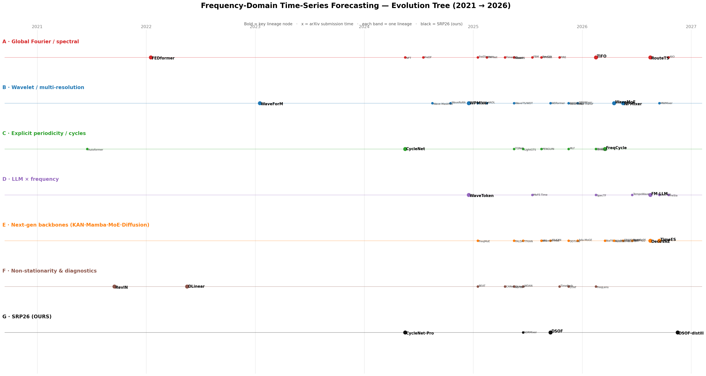
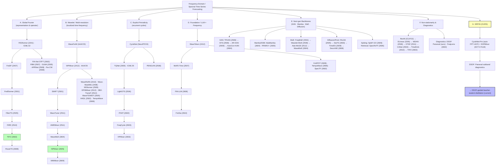

# Frequency-Domain Time-Series Forecasting — Timestamped Evolution Tree

> **Purpose:** One-page shared map of the field for delegation. Shows the **lineages** (who descends from whom), **timestamps** (arXiv YYMM), and **work lanes** so each person can own a subfield.
> **Last updated:** 2026-11-12 · **Coverage:** 75 papers (2021–Oct 2026) + our SRP26 project position.

---

## 1. The Evolution Tree (lineages)

> **Readable full-res image:** [`model_evolution_tree.png`](file:///d:/uni/SRP26/docs/model_evolution_tree.png) — open it and zoom; every model is labeled on its lineage band.

Source diagram (mermaid — renders on GitHub, not in plain preview)

---

## 2. Timestamped Chronology (arXiv YYMM)

### 2021–2022 — Foundations
| Stamp | Model | Venue | One-line contribution |
|---|---|---|---|
| 2106 | Autoformer | NeurIPS'21 | Autocorrelation attention (time-domain periodicity precursor) |
| 2109 | RevIN | ICLR'22 | Reversible instance normalization (kills distribution shift) |
| **2201** | **FEDformer** | **ICML'22** | **The founding frequency model — random/top-k Fourier-mode attention** |
| 2205 | DLinear | AAAI'23 | Moving-average trend/seasonal decomposition baseline |

### 2024 — Frequency goes mainstream
| Stamp | Model | Venue | One-line contribution |
|---|---|---|---|
| 2211 | PatchTST | ICLR'23 | Patching + channel independence (SOTA baseline) |
| — | WaveForM | AAAI'23 | Graph-enhanced multi-scale DWT |
| 2402 | HDMixer | AAAI'24 | Length-extendable patching + hierarchical mixing |
| — | MSGNet | AAAI'24 | Multi-scale FFT for inter-series correlation |
| **2405** | **CycleNet** | **NeurIPS'24** | **Explicit residual cycle forecasting (our direct parent)** |
| 2405 | NFT | — | Neural Fourier Transform (interpretable) |
| 2407 | FreDF | — | "Not all frequencies are equal" — per-frequency transfer function |
| 2408 | Wave-MaskMix | — | DWT as data augmentation |
| 2410 | WaveRoRA | — | Wavelet + linear-complexity rotary-route attention |
| 2412 | WPMixer | AAAI'25 | Wavelet patch mixing |
| 2412 | WaveToken | — | Wavelet tokenization for foundation models |

### 2025 — The explosion (wavelets, KAN, MoE, LLM)
| Stamp | Model | One-line contribution |
|---|---|---|
| 2501 | FreEformer | DFT→Transformer over spectrum, real/imag independently |
| 2501 | FreqMoE | Frequency-band mixture-of-experts (<50k params) |
| 2501 | SWIFT | Lossless wavelet downsampling, ultra-lightweight |
| 2501 | BEAT | Balanced gradient modulation across wavelet subbands |
| 2502 | HADL | DWT+DCT denoising + low-rank linear head |
| 2502 | ReFocus | Re-energize the neglected mid-frequency band |
| 2502 | FIA-Net | STFT + hyper-complex MLP (fewer params) |
| 2504 | Times2D | 1D→2D frequency reshaping + derivative heatmaps |
| 2504 | CANet | Fourier adaptive thresholding + non-stationary norm |
| 2505 | FilterTS | Cross-variable frequency filtering (conv→multiply) |
| 2505 | AEFIN | Fourier + cross-attention for non-stationary |
| 2505 | FALDA | Fourier decomposition + conditional diffusion |
| 2505 | OLMA | Frequency-domain supervision loss (entropy reduction) |
| 2505 | WaveTS/WDT | Multi-order wavelet *derivative* transform |
| 2505 | Sonnet | Learnable wavelet + Koopman spectral operator |
| 2505 | TQNet | Temporal queries (ICML'25) |
| 2505 | OLinear | Data-adaptive orthogonal transform + linear |
| 2506 | WDAN | Wavelet disentangled adaptive normalization |
| 2506 | LightGTS | Periodical tokenization, lightweight foundation |
| 2506 | TFKAN | Dual time+frequency KAN branches |
| 2507 | MoFE-Time | Time+frequency MoE, pretrain-finetune |
| 2507 | FBM | Fourier basis mapping (plug-and-play) |
| 2508 | KFS | KAN + Parseval-based dominant frequency selection |
| 2508 | Wavelet-MoE | Wavelet + MoE channel clustering |
| 2508 | APRNet | Amplitude-phase reconstruction (KAN local correlation) |
| 2508 | Fre-CW | Frequency-domain adversarial attack |
| 2508 | PENGUIN | Periodic-nested group attention |
| 2509 | AR-KAN | Autoregressive-weight-enhanced KAN |
| 2509 | WDformer | Wavelet + differential attention |
| 2510 | TimeEmb | Static-dynamic disentangle + frequency filtering |
| 2510 | FIRE | Amplitude/phase independent modeling (interpretable) |
| 2511 | AWEMixer | FFT router + adaptive wavelet subband weighting |
| 2511 | DTAF | Temporal stabilization + frequency differencing |
| 2511 | MLF | Multi-period learning for finance |
| 2511 | FreDN | Learnable frequency disentanglement + ReIm sharing |
| 2511 | DDTime | Spectral-alignment dataset distillation |
| 2511 | WaveTuner | Full-spectrum wavelet subband tuning (KAN) |
| 2512 | Ada-MoGE | Adaptive Gaussian MoE (0.2M params) |
| 2512 | DPWMixer | Lossless Haar wavelet pyramid |
| 2512 | DB2-TransF | Learnable Daubechies wavelets replace attention |

### 2026 — Adaptive, conditional, and LLM-integrated
| Stamp | Model | One-line contribution |
|---|---|---|
| 2601 | Dualformer | Layer-wise frequency band allocation |
| 2601 | AWGformer | Adaptive wavelet-guided transformer (ICASSP'26) |
| 2601 | Dec. Forward Diffusion | Spectral-aware diffusion forward process |
| 2602 | TFMixer | NUDFT for *irregular* time series |
| 2602 | PHAT | Period *heterogeneity* (3D periodic bucket) |
| 2602 | SpecTF | Text↔spectral fusion (multimodal) |
| 2602 | FreqLens | Learnable frequency discovery + Shapley attribution |
| 2602 | HPMixer | Periodicity + learnable stationary wavelet (PAKDD'26, Choi) |
| **2602** | **TIFO** | **Time-invariant frequency operator (stationarity-aware weights)** |
| 2603 | StaTS | Spectral trajectory schedule (diffusion) |
| 2603 | FreqCycle | Low-freq cycle + mid/high-freq filter enhancement |
| 2603 | xCPD | Graph spectral channel-patch routing (ICLR'26) |
| 2604 | WaveMoE | Wavelet-MoE foundation model (ICLR'26 WS) |
| 2604 | TriTS | Time+frequency+2D-vision disentanglement |
| 2604 | AdaMamba | Adaptive frequency-gated Mamba |
| 2604 | AutoCorr-KAN | Autocorrelation reintroduces spectral bias (DCT fix) |
| **2605** | **NPMixer** | **Learnable stationary wavelet patch mixer (Choi · Schmidt-Thieme)** |
| 2605 | FRWKV+ | Frequency-space linear + periodic-position gating |
| 2606 | FAiT | Inverted attention as high-pass complement |
| 2606 | SpikF-GO | Spiking Fourier graph operators (ECML'26) |
| 2606 | McWC | Cyclicity + wavelet + channel correlation |
| 2606 | SpecReTF | Spectral retrieval-augmented forecasting |
| 2606 | TempoWave | Multi-wavelet number embeddings for LLMs (IJCAI'26) |
| 2608 | RouteTS | **Route dominant freqs to freq domain, residual to time** |
| 2608 | FM-LLM | Frequency-MoE for frozen LLMs |
| 2608 | DecoVAE | Complex-Gaussian seasonal VAE (interpretable) |
| 2609 | CoSPOT | Compositional spectral prompts (CIKM'26) |
| 2609 | MWMixer | Multi-scale frequency compensation (CIKM'26) |
| 2609 | TimeES | Evolutionary spectra framework (NeurIPS'26) |
| 2610 | FreSia | Frequency-semantic alignment for LLMs |
| 2610 | AliO | Time+frequency output alignment (NeurIPS'25) |

---

## 3. Paradigm shifts (the "why" behind the tree)

1. **Representation shift:** global Fourier (2022–24) → localized **wavelets** (2025–26), because FFT leaks on non-stationary data.
2. **Parameter shift:** heavy attention (2022) → **lightweight mixers/linears** (2024–25) → **MoE/state-space** (2025–26).
3. **Target shift:** static preprocessing → **learnable in-model spectral operators** (FreDN, FIRE, TIFO, DB2-TransF).
4. **Integration shift:** frequency as a standalone model → **frequency as a module inside LLMs/KAN/Mamba/diffusion** (2026).

---

## 4. Delegation lanes (work packages)

| Lane | Owner | Papers to own | Deliverable |
|---|---|---|---|
| **L1 — Fourier/spectral** | ? | FEDformer, FreDF, FreEformer, FilterTS, FIRE, TIFO, RouteTS, FIA-Net, FBM, OLMA, APRNet, Fre-CW | "When does a global spectral operator help vs. hurt" |
| **L2 — Wavelet/multi-res** | ? | WaveForM, WPMixer, SWIFT, WaveTuner, AWEMixer, WaveMoE, NPMixer, MWMixer, WaveRoRA, WDformer, DPWMixer, DB2-TransF, WaveTS, HADL, TempoWave | "Wavelet vs. FFT for non-stationary data" |
| **L3 — Periodicity/cycles** | ? | CycleNet, TQNet, LightGTS, PHAT, FreqCycle, HPMixer, PENGUIN | "Automated period discovery & cycle modeling" |
| **L4 — LLM × frequency** | ? | WaveToken, MoFE-Time, FM-LLM, FreSia, CoSPOT, TempoWave, SpecTF | "Injecting frequency into frozen LLMs" |
| **L5 — Backbones & training** | ? | TFKAN, KFS, AR-KAN, AutoCorr-KAN, AdaMamba, FRWKV+, FreqMoE, Ada-MoGE, FALDA, StaTS, TimeES, DecoVAE, SpikF-GO, SpecReTF, DDTime | "Spectral modules in KAN/Mamba/MoE/diffusion + distillation" |
| **L6 — Non-stationarity & diagnostics** | ? | RevIN, DLinear, WDAN, DTAF, CANet, TimeEmb, FreqLens + **our DSOF** | "Boundary conditions + spectral diagnostics" |

---

## 5. Where SRP26 sits (what we're up to)

- **Parents:** CycleNet (periodicity) + FEDformer/FreDF (frequency) + the 2025–26 wavelet/adaptive line.
- **Our models:** **CycleNet-Pro** (automated FFT+ACF period discovery, 4 backbones incl. SORMixer = DCT-II spectral FiLM) — evaluated on 8 benchmarks, L=336, H∈{96,192,336,720}.
- **Our diagnostic:** **DSOF** — Parseval-exact subband error decomposition (MSE = low+mid+high, exactly), FVU, Log-Spectral Distance, rolling-window failure localization.
- **Current direction (for delegation):** **DSOF-guided teacher–student distillation** — a tiny hybrid time+frequency student distilled from a foundation teacher (IBM Granite TTM-R1 = efficiency winner, 805K; or TimesFM 2.5 = accuracy winner), with **band-selective spectral loss**, evaluated by DSOF. Open question: distill *values*, *spectra*, or *both* — and whether a foundation teacher's blurry spectrum is worth copying at all.
