# Research & Execution Plan: 2-Month Synchronous Team Roadmap

This plan outlines a highly practical, **synchronous team workflow** where all **5 Master's students** move through the phases together as a single, unified research unit. This eliminates the risk of siloed failure, ensures everyone learns the same material, and focuses on collective execution.

---

## The Co-Op Team Model (Synchronous Execution)
Instead of dividing the team into specialized, independent roles, the entire team functions as a **single development and research squad**. 
* **Collective Ownership:** Everyone reads the same papers, everyone participates in coding sessions, everyone submits experiments on the `bigmama` cluster, and everyone writes sections of the paper.
* **Mob Programming & Study:** Coding and literature analysis are done in collaborative sessions (e.g., screen sharing, joint whiteboarding) so no single student gets stuck.

---

## 8-Week Synchronous Timeline

```mermaid
stateDiagram-v2
    [*] --> Phase1: Weeks 1-2
    note right of Phase1
      <b>Collective Study & Setup</b>
      - Everyone reads the same 3 papers
      - Joint cluster setup & test run
    end note
    
    Phase1 --> Phase2: Weeks 3-4
    note right of Phase2
      <b>Collaborative Coding</b>
      - Pair programming on models & metrics
      - Joint writing of SLURM templates
    end note
    
    Phase2 --> Phase3: Weeks 5-6
    note right of Phase3
      <b>Unified Experiments</b>
      - Divide datasets, run same pipeline on bigmama
      - Joint analysis of failure cases
    end note
    
    Phase3 --> Phase4: Weeks 7-8
    note right of Phase4
      <b>Co-Authoring & Defense</b>
      - Shared LaTeX writing
      - Group mock presentations
    end note
    
    Phase4 --> [*]
```

---

### **Phase 1: Collective Study & Cluster Onboarding (Weeks 1-2)**
* **Primary Objective:** Build a shared baseline of theoretical knowledge and ensure everyone can run code on `bigmama`.
* **Synchronous Activities:**
  * **Joint Literature Review:** The entire team reads and discusses the same 3 core papers: *FEDformer*, *CycleNet*, and *WPMixer*. During meetings, each team member explains a different section of the same paper to ensure 100% conceptual alignment.
  * **Group Cluster Setup:** The team meets in a shared session to log into the `bigmama` cluster together. Every student sets up their own user access and runs a simple, pre-written test script using `uv` to confirm their personal configuration works.
  * **Dataset Verification:** Together, the team inspects the raw ETT, Weather, and Traffic datasets to understand how columns, timestamps, and normalization values are structured.

---

### **Phase 2: Collaborative Coding & Development (Weeks 3-4)**
* **Primary Objective:** Develop the hybrid model, the metric suite, and submission templates together.
* **Synchronous Activities:**
  * **Mob Coding (`models.py`):** The team codes the `SpectralProjectionBranch` and the hybrid `FreqEnhancedDLinear` model together. One person shares their screen and codes, while the other four review the PyTorch FFT math in real time.
  * **Mob Coding (`metrics.py`):** The team builds the digital Butterworth filters, Spectral Coherence, and Log-Spectral Distance metrics together, verifying the code against simple synthetic test signals (e.g., pure sines and white noise).
  * **Shared SLURM Templates:** The team designs a single, master SLURM bash script template. Everyone reviews the resource requests (`#SBATCH` parameters for GPUs, CPUs, VRAM, and wall-time limits) to ensure jobs won't get rejected by the cluster scheduler.

---

### **Phase 3: Unified Cluster Execution & Joint Analysis (Weeks 5-6)**
* **Primary Objective:** Run the full experimental grid on `bigmama` and analyze failures together.
* **Synchronous Activities:**
  * **Dividing the Run Grid:** The team splits the runs to save time, but everyone uses the **exact same code and submission script**:
    * Student 1: Runs all models on ETTh1 and ETTh2.
    * Student 2: Runs all models on ETTm1 and ETTm2.
    * Student 3: Runs all models on Weather.
    * Student 4: Runs all models on Traffic.
    * Student 5: Runs cross-validation grid searches on lookback and prediction lengths.
  * **Group Failure Diagnostics:** The team meets to inspect the logs and plots. Together, they review the worst prediction windows and discuss the behavior of the learnable gating parameter $\alpha$ (e.g., "Why did $\alpha$ drop to 0.1 during this weather storm?").

---

### **Phase 4: Co-Authoring & Group Defense Prep (Weeks 7-8)**
* **Primary Objective:** Co-write the final paper in LaTeX and practice the oral defense.
* **Synchronous Activities:**
  * **Collaborative Writing:** The team uses a shared LaTeX workspace (like Overleaf) to write the paper. They divide sections (Introduction, Methodology, Experimental Setup, Results, Conclusion), but peer-review each other's text daily for mathematical consistency.
  * **Figure Selection:** The team collectively reviews and selects the best prediction graphs, PSD curves, and coherence plots to include in the paper.
  * **Group Mock Defenses:** The team takes turns presenting the slides, while the other members act as the professor and supervisor (Jung Min Choi), asking challenging questions to prepare for the final evaluation.
