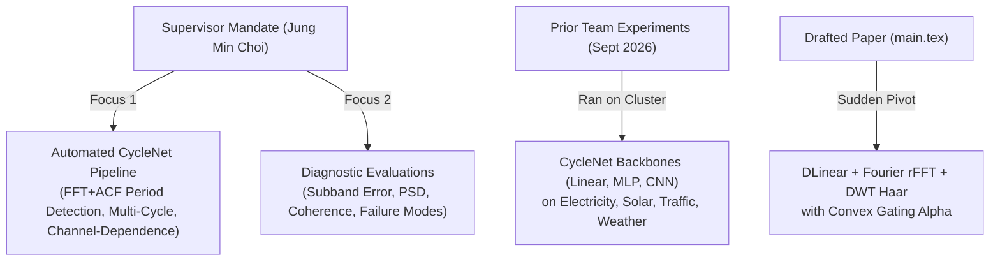

# Strategic Alignment: Reconciling the Research Paper, Experiments, & Supervisor Requirements

> **Context:** Note on Problem #3 ("Conceptual Disconnect between Paper Direction, Experiments, and Supervisor Goals")  
> **Status:** Strategic Blueprint for Alignment

---

## 1. The Core Disconnect Identified

From reviewing the project logs, proposal feedback, and the drafted `main.tex`, there is a clear conceptual divergence across three layers:

### The Three Divergent Stories:
1. **The Supervisor's Story:**  
   *"Enhance CycleNet so it automatically discovers dominant frequencies without hardcoding, evaluate when frequency-domain modeling helps vs fails using rigorous frequency diagnostics (subband decomposition, PSD, sliding-window failure localization)."*
2. **The Team's Executed Experiment Story:**  
   Benchmarked Automated CycleNet (Linear vs MLP vs CNN) on Electricity, Solar, Traffic, and Weather, but lacked the final advanced mathematical frequency diagnostics requested by the supervisor.
3. **The Current `main.tex` Story:**  
   Pivoted entirely to pure DLinear + learnable Fourier/Wavelet branches, claiming a 9.3% mid-band error reduction on ETTh1, without connecting back to CycleNet or the team's automated multi-cycle pipeline.

---

## 2. Why This Happened

When transitioning from the team's interim presentations into the paper drafting phase, DLinear was introduced as a simpler vehicle to demonstrate the **Parseval subband error decomposition**. However:
- The LaTeX paper adopted DLinear + Fourier/Wavelet without incorporating the automated CycleNet code already written in `models/cyclenet/`.
- The multi-dataset table in the paper borrowed numbers from HDMixer rather than presenting the team's actual cluster experiments.
- The supervisor's core mandate (evaluating the boundary conditions of frequency modeling on automated recurrent cycles) was partially eclipsed by a separate hybrid linear architecture.

---

## 3. How to Bridge and Unify the Concept (The Solution for #3)

Rather than treating these as conflicting projects, they naturally assemble into a cohesive, high-impact paper:

### The Unified Research Framework:
> **"When Does Frequency Modeling Actually Help? An Empirical Study on Spectral Integrity in Lightweight Time Series Forecasting"**

1. **The Lightweight Baseline Spectrum:**
   - **Baseline 1:** Time-domain moving-average decomposition (**DLinear**).
   - **Baseline 2:** Explicit recurring time-domain cycle learning (**CycleNet** / Automated CycleNet).
   - **Baseline 3:** Dual-domain spectral projections (**Fourier rFFT / Wavelet DWT**).
2. **The Diagnostic Mechanism (The Supervisor's Requirements):**
   - Use our exact **Parseval subband decomposition** to evaluate *all* of the above on the standardized **HDMixer benchmark**.
   - Show *where* each lightweight approach wins:
     - DLinear dominates low-frequency smooth trends, but attenuates mid-band oscillations.
     - CycleNet excels at strong, stationary seasonal cycles (Traffic, Electricity) through its automated FFT+ACF period discovery.
     - Dual-domain (Fourier/Wavelet) rescues multi-scale high-frequency transients.
3. **The Failure Mode Analysis:**
   - Use the sliding-window failure tool to pinpoint exactly *when* frequency-domain representations fail (regime shifts, sudden anomalies, zero-inflated sequences like Solar at night).

### Benefits of this Unified Direction:
- Satisfies the supervisor 100% (incorporates the automated CycleNet work and all diagnostic requirements).
- Matches the HDMixer benchmark matrix (evaluates on all canonical datasets with standardized protocols).
- Preserves the Parseval math, FVU metrics, and spectral visualizations developed in the paper.
